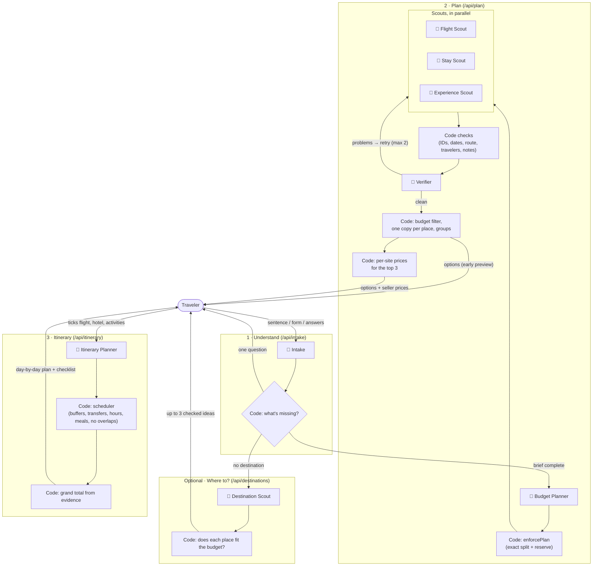
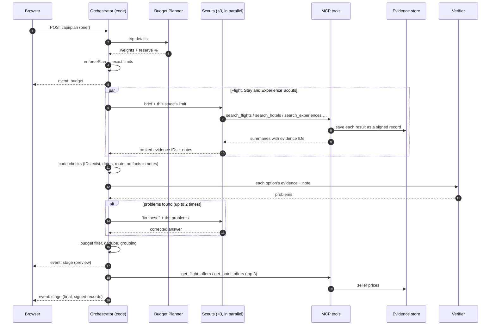

# Agents and orchestration

Wayfare uses eight AI agents. Each one has a single job, its own instructions, a short list of tools it may call, a strict output format, a step limit and a timeout. A plain-code **orchestrator** decides which agent runs when, checks what they return, and does everything that must be exact (money, time, booking links).

For the full request flow and where data is stored, see [architecture.md](architecture.md).

## Ground rules every agent follows

1. **Facts come from tools only.** Agents reach the outside world through MCP tools. Every tool result is saved as a signed *evidence record*, and the tool gives the agent its ID.
2. **Agents answer with evidence IDs and short reasons.** A scout says "`ev_8f2…`: direct, good arrival time", never "€182, lands 14:05". The UI shows prices, times, ratings and links from the evidence records.
3. **Answers are checked.** Every answer must match a zod schema, and the agent gets one corrective retry if it doesn't. IDs that don't exist are rejected. Notes that contain prices, times or links are cleaned.
4. **Provider text is never an instruction.** Hotel descriptions and reviews aren't sent to the model at all.
5. **Everything is bounded:** step limit and timeout per agent, a token cap and a provider-call cap per plan.

## The agents

| # | Agent | Job | Tools it may call | Returns | Limits |
| --- | --- | --- | --- | --- | --- |
| 1 | **Intake** | Turns the traveler's sentence, form and answers into a structured trip brief. Never invents a destination, dates, budget or origin. | `lookup_airport` | Brief fields, assumptions, one optional question | 6 steps, 60 s |
| 2 | **Destination Scout** | Only when no destination was given. Suggests up to 3 places and finds a real flight and hotel for each. | `lookup_airport`, `search_flights`, `search_hotels` | Places with a flight ID and a hotel ID each | 24 steps, 240 s |
| 3 | **Budget Planner** | Proposes how to split the total across flights, stay and activities, plus a spending reserve. | `convert_currency` | Weights, reserve %, one reason per part | 4 steps, 60 s |
| 4 | **Flight Scout** | Finds round trips and ranks them by price, duration, stops and sensible times. | `search_flights`, `lookup_airport` | Up to 10 ranked flight IDs + notes | 6 steps, 150 s |
| 5 | **Stay Scout** | Finds hotels under the stay limit and ranks them by price, rating, location and interests. | `search_hotels` | Up to 10 ranked hotel IDs + notes | 5 steps, 200 s |
| 6 | **Experience Scout** | Finds things to do: a group per interest, plus **Don't miss** (the place's signature sights) and **Theme parks** when there are any. | `search_experiences`, `search_attractions`, `get_place_details`, `geocode` | Groups of activity IDs + notes | 16 steps, 180 s |
| 7 | **Verifier** | Reads each option's evidence and the scout's note. Flags notes that claim something the evidence doesn't support, and options that don't match the trip. | none | A list of problems (empty = all good) | 2 steps, 60 s |
| 8 | **Itinerary Planner** | Decides which day each chosen activity happens and in what order, grouping nearby places and keeping travel days light. | `travel_time` | Activity IDs in order, each with a preferred day | 8 steps, 120 s |

Definitions live in `src/server/agents/defs/` (`intake.ts`, `scouts.ts`). The shared runner, `src/server/agents/runner.ts`, handles the tool loop, structured output, retries, timeouts, token counting and the trace. Each agent can use its own model or reasoning effort: `OPENAI_MODEL_<AGENT>` / `OPENAI_REASONING_EFFORT_<AGENT>`, for example `OPENAI_REASONING_EFFORT_ITINERARY_PLANNER=high`.

### Tools (MCP servers)

The four tool servers run inside the app (`src/server/mcp/servers/`). An agent can only see the tools listed for it above.

| Server | Tools | Backed by |
| --- | --- | --- |
| `reference` | `lookup_airport`, `convert_currency`, `get_rates`, `geocode`, `travel_time` | OurAirports data, Frankfurter (ECB rates), Google Places / Routes |
| `flights` | `search_flights`, `get_flight_offers` | Kiwi.com (MCP), Apify Google Flights |
| `stays` | `search_hotels`, `get_hotel_offers` | Apify Google Hotels |
| `experiences` | `search_experiences`, `search_attractions`, `get_place_details` | Viator, Google Places |

The orchestrator also calls some tools directly, without an agent: `get_flight_offers` / `get_hotel_offers` (prices per booking site for the top 3), `get_rates` (currency conversion) and `travel_time` (transfers in the itinerary).

## Orchestration

The orchestrator is code, not an agent, because the order of steps is fixed and must be reliable. Its job is to:
- start agents in the right order, in parallel where possible;
- check every answer;
- send problems back for a retry;
- keep one failing stage from sinking the others;
- stream progress to the browser.

### How the agents interact

Agents never call each other directly. Everything goes through the orchestrator and the evidence store:

### What happens when something fails

| Failure | What the orchestrator does |
| --- | --- |
| An agent's answer doesn't match its schema, or uses unknown IDs | One corrective retry with the problems listed, then the stage fails with a clear message |
| The Verifier finds problems | The scout gets the list and tries again (max 2). Options still flagged are dropped. Problems that only affect a note keep the option. |
| One stage fails (for example, the hotel provider is down) | `stage_error` for that stage only. Flights and activities still arrive. |
| A provider key is missing | The tool says so. The capability report and the affected screen explain what's missing and how to add it. |
| Token or provider-call cap reached | The request stops with "Start a new plan, or raise MAX_TOKENS_PER_PLAN / MAX_PROVIDER_CALLS_PER_PLAN" |
| The traveler cancels | The request is aborted. Agents and tool calls stop. |

### Why the orchestrator isn't an agent

The steps always happen in the same order: understand, budget, search, verify, schedule. A model choosing that order would add cost and new ways to fail, without making any real decision. So the judgment calls (what the traveler meant, which options are good, which day suits a museum) go to agents, and the exact work (sums, limits, clocks, links) stays in code.
