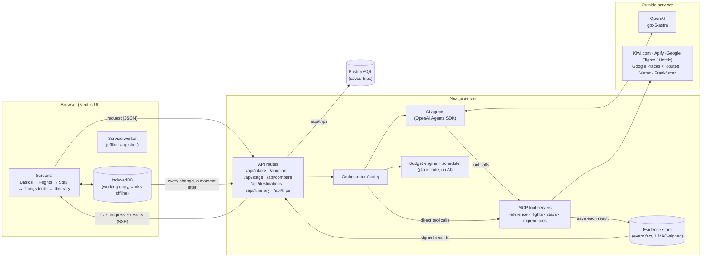
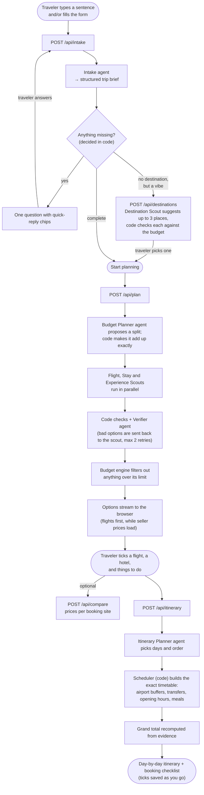
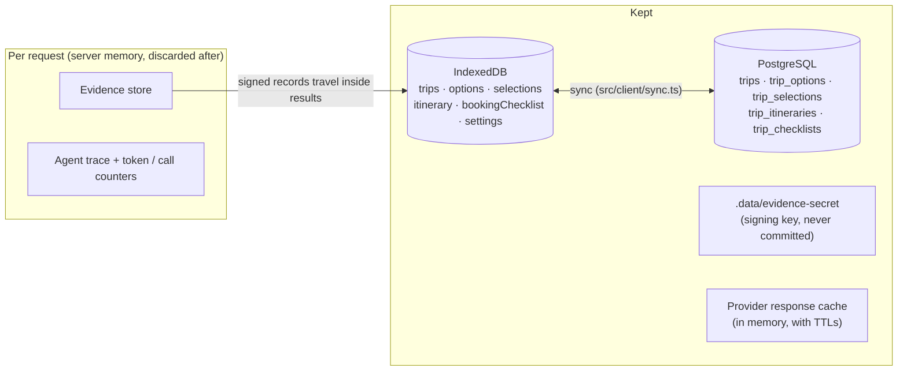

# How Wayfare works

This document follows a trip from the first sentence the traveler types to the last thing they see: the day-by-day itinerary. It covers where each piece of output is produced, where it is stored, and what happens in between. The agents themselves are described in [agents.md](agents.md).

## The big picture



**In one paragraph:** the browser sends what the traveler typed to an API route. The route starts the **orchestrator**, which is ordinary code that decides what runs and in what order. The orchestrator asks **AI agents** to do the judgment work (understand the request, pick good options). The agents can't make anything up: they only reach the outside world through **MCP tools**, and every tool result is saved as a signed **evidence record**. Agents answer with evidence IDs and short notes, never with prices or times. **Plain code** then enforces the budget and builds the timetable. Results stream back to the browser as they're ready. The browser stores them in **IndexedDB** and mirrors every trip to **PostgreSQL**.

## Step by step: from first input to final itinerary



### 1. Understanding the request (Basics)

| | |
| --- | --- |
| **Input** | Free text ("long weekend in Lisbon in December, two of us, €1,500"), optional form fields, earlier answers |
| **Route** | `POST /api/intake` → `src/server/orchestrator/intake.ts` |
| **Who does what** | The **Intake agent** turns the text into a structured brief. **Code** decides what is still missing and asks about one thing at a time, in a fixed order (origin, destination, dates, nights, travelers, budget). Safe defaults (for example rooms = travelers ÷ 2) are filled in and shown as editable assumptions. |
| **Output** | A trip brief + at most one question |
| **Stored in** | Browser: `trips.intake` and `trips.brief` → mirrored to PostgreSQL `trips` |

If the traveler didn't name a place, `POST /api/destinations` asks the **Destination Scout** for up to three ideas. Each idea comes with a real flight and hotel, and code checks that they fit the budget before showing it.

### 2. Planning (Flights, Stay, Things to do)

| | |
| --- | --- |
| **Input** | The complete brief |
| **Route** | `POST /api/plan` → `src/server/orchestrator/stages.ts` |
| **Who does what** | The **Budget Planner** proposes how to split the money; `enforcePlan` (code) makes the parts add up to the exact total and keeps a reserve for food and transport. Then the **Flight, Stay and Experience Scouts** search in parallel. Each scout's picks go through code checks (right dates, route, travelers, known IDs, no facts in notes) and the **Verifier** agent. Problems go back to the scout, up to 2 retries. The budget engine hides anything over its limit. |
| **Output** | Per stage: options (evidence IDs + notes) and the signed evidence records behind them |
| **Stored in** | Browser: `options` table (one row per stage) → PostgreSQL `trip_options` |

Results are sent as **Server-Sent Events** while the work is still running:

| Event | Meaning |
| --- | --- |
| `progress` | A named step ("Flight Scout is searching…"), shown in the progress panel |
| `budget` | The budget split |
| `stage` | A stage's options. Flights and hotels are sent once *before* the slower per-site price check, then again with it. |
| `stage_error` | One stage failed. The others carry on. |
| `result` | The single answer of the other routes (intake, destinations, compare, itinerary) |
| `error` | The whole request failed, with a plain-language next step |

**Selections** (ticking a flight, a hotel or activities) happen in the browser. The same budget engine runs there, so an option that would break the budget is blocked with an explanation, without a server round trip. Selections are stored in `selections` → PostgreSQL `trip_selections`.

**Compare prices** (`POST /api/compare`) fetches prices from each booking site for one flight or hotel. The result is added to that stage's stored options.

### 3. The itinerary

| | |
| --- | --- |
| **Input** | Brief, budget plan, selections, and the signed records the browser kept |
| **Route** | `POST /api/itinerary` → `src/server/orchestrator/itinerary.ts` |
| **Who does what** | The server first checks every record's signature. The **Itinerary Planner** agent picks which day each activity happens and in what order. The **scheduler** (`src/lib/itinerary/scheduler.ts`, plain code) places everything on the clock: leave for the airport, airport buffer (3h international / 2h domestic), flights, arrival buffer, transfers with real travel times from Google Routes, check-in/out, meals, and activities inside their opening hours or time slots. Nothing overlaps. The grand total is recomputed from the evidence. |
| **Output** | Days → timed items, problems ("Belém Tower didn't fit"), grand total, and a booking checklist |
| **Stored in** | Browser: `itinerary` and `bookingChecklist` → PostgreSQL `trip_itineraries` and `trip_checklists` |

Ticking items off and marking bookings as done update the same rows.

## Where data lives



- **Evidence records** are the only source of facts. Every tool result becomes one: an ID, its source ("Kiwi.com", "Google Places"…), when it was fetched, and normalized fields. The server signs each one with HMAC-SHA256. The browser stores them as they are, and sends them back when they're needed again (for example to build the itinerary after a server restart). The server only accepts records whose signature checks out, so the browser can't change a price.
- **IndexedDB** (via Dexie, `src/client/db.ts`) is the working copy. The UI reads only from it, so screens update instantly and the app works offline.
- **PostgreSQL** (`src/server/db/`) is the durable copy. `src/client/sync.ts` watches every IndexedDB table that holds part of a trip. A moment after a change, it saves the whole trip with `PUT /api/trips/:id`, in one database transaction. On start, `GET /api/trips` brings in trips this browser doesn't have, or has an older copy of. Offline changes are saved when the connection comes back. Without `DATABASE_URL`, the app keeps trips in the browser only.
- The browser-only `settings` table (default currency and buffer preferences) is not synced.

### Database tables

| Table | One row per | Main columns |
| --- | --- | --- |
| `trips` | trip | `id`, `name`, `status`, `stage`, `brief` (jsonb), `budget_plan` (jsonb), `intake` (jsonb, the conversation so far), `created_at`, `updated_at` |
| `trip_options` | trip + stage (`destinations`, `flights`, `stay`, `activities`) | `data` (jsonb: options + signed evidence), `fetched_at` |
| `trip_selections` | trip | `data` (jsonb: flight ID, hotel ID, activity IDs, chosen sellers) |
| `trip_itineraries` | trip | `data` (jsonb: days, items, totals, evidence) |
| `trip_checklists` | trip | `items` (jsonb: what's booked) |

All child tables use `ON DELETE CASCADE`, so deleting a trip removes everything that belongs to it. `npm run db:setup` creates the database and the tables. The server also creates the tables on first use if they're missing.

## Rules the design enforces

| Rule | Where |
| --- | --- |
| No made-up facts: agents return evidence IDs, unknown IDs are rejected, and notes containing prices, times or links are cleaned | `server/agents/defs/scouts.ts`, `orchestrator/stages.ts`, `evidence/store.ts` |
| Missing data says "Not provided by source" instead of guessing | provider adapters leave fields empty; cards show `NotProvided` |
| The budget is enforced by code, not by the model | `lib/budget/engine.ts` (same code on server and in the browser) |
| API keys never reach the browser, the model or the logs; Google photos are proxied | `server/providers/*`, `/api/photo`, `redact()` |
| Text from providers (hotel descriptions, reviews) is data, never instructions | `modelSafe()` keeps it out of the model's input |
| Everything is bounded: step limits, timeouts, a token cap and a provider-call cap per plan, rate limit, cache | `agents/runner.ts`, `agents/context.ts`, `providers/guard.ts`, `http/ratelimit.ts` |
| Nothing is booked in the app; booking links open the provider's site | `lib/booking-links` |
| Demo data only with `ALLOW_DEMO_DATA=true`, always with a visible banner | `server/demo`, `AppShell` |

## Source map

```
src/
  app/                    Next.js pages and API routes (app/api/*/route.ts)
  components/             UI (React + Tailwind + Framer Motion)
  client/                 Browser logic: IndexedDB (db.ts), actions (planner.ts), sync to PostgreSQL (sync.ts)
  lib/                    Shared by server and browser: schemas, budget engine, scheduler, money, booking links
  server/
    orchestrator/         The code that runs each request (intake, plan, stages, compare, itinerary)
    agents/               Agent runner and the agent definitions (defs/)
    mcp/                  MCP host and the four tool servers
    providers/            Adapters for Kiwi, Apify, Google, Viator, Frankfurter (+ cache and call limits)
    evidence/             Evidence store and signing
    db/                   PostgreSQL: schema, pool, trip repository
    http/                 SSE streaming, errors, rate limiting
    demo/                 Fixture providers + scripted model (only with ALLOW_DEMO_DATA=true)
test/                     Test helpers, fixtures and stubs
scripts/                  Command-line tools (database setup, live smoke tests, browser checks)
```
